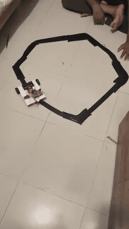
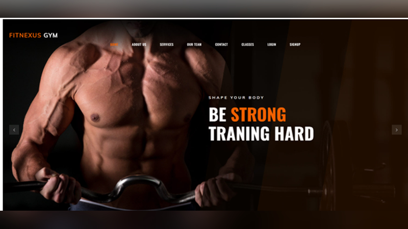
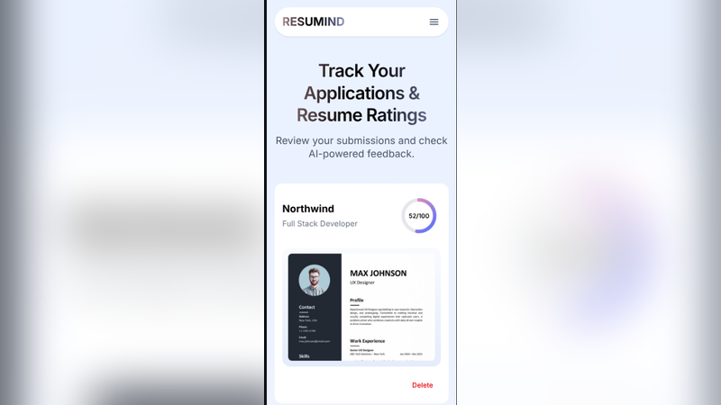
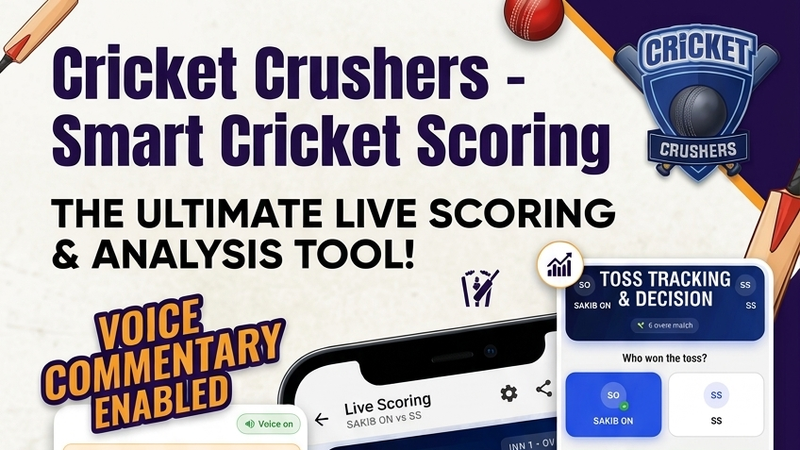
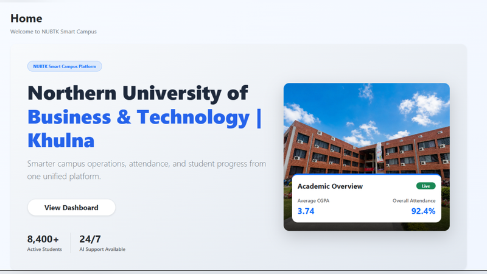
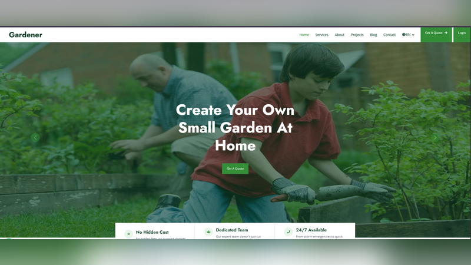
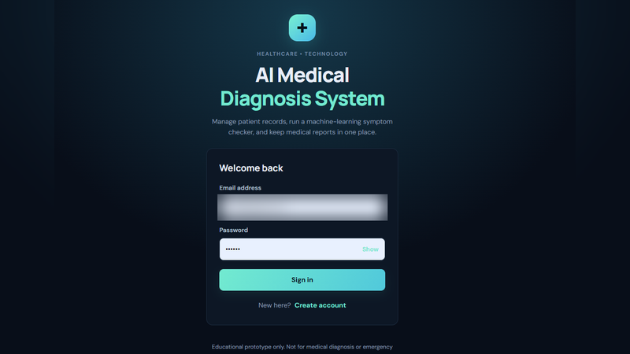
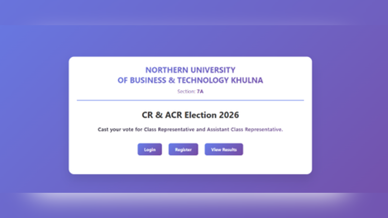

  <!-- Header: Dark Slate to Sky Blue Gradient -->
  
   
  <!-- Animated Typing Text -->
  

 

  
  
  

 

### 👨‍💻 About Me

I am a passionate web developer currently pursuing my B.Sc. in Computer Science and Engineering. I love solving real-world problems, turning ideas into responsive, user-friendly web applications, and building hardware projects with Arduino.

*   **🎓 Education:** B.Sc. in Computer Science & Engineering
*   **📍 Location:** Khulna, Bangladesh
*   **🌱 Currently Exploring:** Cloud Computing, Advanced Web Development & Embedded Systems
*   **🤖 Hardware side:** Arduino, sensors, motor drivers and robotics projects
*   **💼 Open to:** Junior Web Developer Roles, Internships, Freelance

---

### 🛠️ Technology Stack

  <b>Backend & Data</b> 
    

  <b>Languages & Web</b> 
    

  <b>Embedded & Hardware</b> 
    

  <b>Developer Tools</b> 
  

---

### 🚀 Featured Project

<table align="center" border="0" cellpadding="10" width="100%">
  <tr>
    <td width="30%" align="center" valign="middle">
      
    </td>
    <td width="70%" valign="top">
      <h3>🤖 <a href="https://github.com/sakib916sk/line-follower-robot-arduino">Autonomous Line Follower Robot</a></h3>
      
A 2-wheel robot car that follows a black line completely on its own. It uses IR sensors for line detection, PWM speed control through an L298N driver, and a line-memory feature that helps it recover when it loses the track. Includes two firmware versions: simple 5-sensor logic and 8-sensor proportional control.

           
    </td>
  </tr>
</table>

---

### 💼 Selected Work

<table align="center" border="0" cellpadding="15" cellspacing="10" width="100%">
  <tr>
    <td width="50%" valign="top">
      
      <h4>🏋️ <a href="https://github.com/sakib916sk/Smart-Gym-Management-System">Smart Gym Management</a></h4>
      
Web-based gym management system for memberships, billing, and class scheduling.

        
    </td>
    <td width="50%" valign="top">
      
      <h4>📄 <a href="https://github.com/mahamud894/AI_Resume_Analyzer">AI Resume Analyzer (Resumind)</a></h4>
      
AI-based resume parsing, rating and feedback tool. Collaborative project.

       
    </td>
  </tr>
  <tr>
    <td width="50%" valign="top">
      
      <h4>🏏 <a href="https://github.com/sakib916sk/Smart-Cricket-Scorer">Cricket Crushers - Smart Cricket Scoring</a></h4>
      
Live cricket scoring and analysis app with voice commentary, toss tracking and quick team and overs setup.

        
    </td>
    <td width="50%" valign="top">
      
      <h4>🧠 <a href="https://github.com/sakib916sk/AI-Smart-Campus-System">AI Smart Campus System</a></h4>
      
AI-powered campus and student-success platform for smarter academic support and services.

          
    </td>
  </tr>
  <tr>
    <td width="50%" valign="top">
      
      <h4>🌿 <a href="https://github.com/sakib916sk/Lawn-Care-Website">Lawn Care Website</a></h4>
      
Responsive landing page for lawn care and gardening services.

        
    </td>
    <td width="50%" valign="top">
      
      <h4>🩺 <a href="https://github.com/sakib916sk/AI-Medical-Diagnosis-System">AI Medical Diagnosis System</a></h4>
      
Manage patient records, run a machine-learning symptom checker, and keep medical reports in one place.

       
    </td>
  </tr>
  <tr>
    <td colspan="2" align="center" valign="top">
      
      <h4>🗳️ <a href="https://github.com/sakib916sk/online_voting">CR & ACR Election System</a></h4>
      
Secure online voting platform for Class Representative elections with real-time results.

         
    </td>
  </tr>
</table>

---

### 📂 More Projects

*   **[Securex](https://github.com/sakib916sk/Securex):** CCTV services, bookings, customer management, and a complete administrative dashboard.
*   **[Logistica](https://github.com/sakib916sk/Logistica):** A complete logistics and courier management web app.
*   **[Arduino-Radar-System](https://github.com/sakib916sk/Arduino-Radar-System):** Ultrasonic sensor-based radar system visualized via Processing.
*   **[DBMS-Project](https://github.com/sakib916sk/DBMS-Project):** Comprehensive database design with complex SQL queries.

---

### 📊 GitHub Analytics

  
  
  

  

<!-- Animated line follower robot (robot-track.svg) -->

  

---

### 🌱 Currently Leveling Up

*   ☁️ Cloud Computing fundamentals
*   🧱 Advanced web development with clean, reusable architecture
*   🤖 Embedded systems and robotics with Arduino

---

  <i>"Always learning, always building."</i>

  

